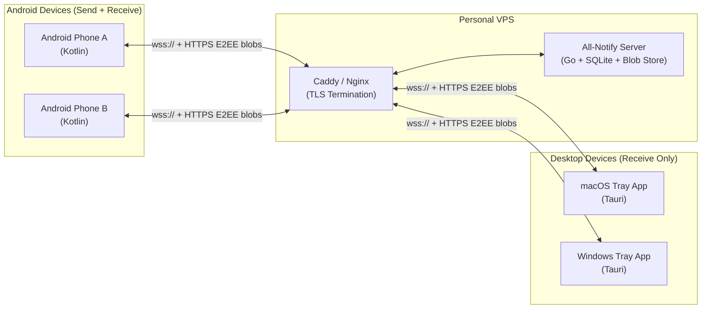
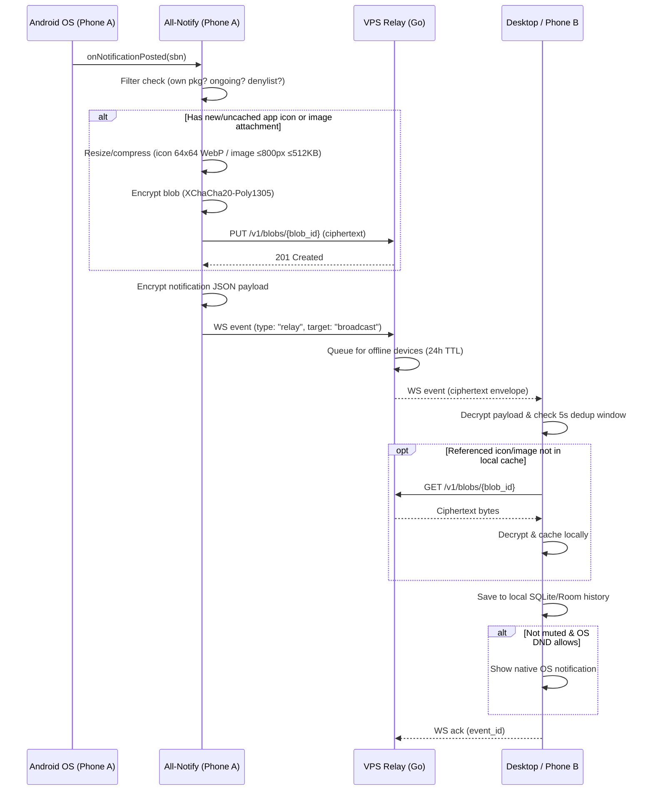

# System Architecture

## High-Level Topology

All-Notify uses a hub-and-spoke relay model. Every device maintains a TLS-encrypted WebSocket (`wss://`) connection to a personal Go server running on your VPS. Payloads are encrypted end-to-end before leaving the sending device; the VPS only routes opaque ciphertext envelopes and temporarily buffers them for offline devices.

## Component Responsibilities

| Component | Language / Stack | Responsibilities |
| :--- | :--- | :--- |
| **Protocol** (`protocol/`) | JSON Schema + Test Vectors | Defines wire envelopes, E2EE primitives, and shared test vectors verified by Go, Kotlin, and Rust test suites. |
| **Relay Server** (`server/`) | Go + SQLite | Authenticates per-device tokens, fans out encrypted WS events to all *other* devices, buffers undelivered events for 24h, serves/reaps 24h-TTL E2EE blobs, mints/revokes device tokens via CLI. |
| **Android Client** (`android/`) | Native Kotlin + Room | Captures OS notifications (`NotificationListenerService`), filters/compresses icons & images, encrypts & sends events, maintains persistent Foreground Service WS, displays mirrored notifications, executes `cancelNotification` on remote dismiss, stores local history. |
| **Desktop Client** (`desktop/`) | Tauri (Rust + SQLite + minimal Svelte/vanilla UI) | Runs in system tray/menu bar, maintains WS connection, decrypts & deduplicates notifications, shows native OS notifications with a **Dismiss** action, sends dismissal events back, stores local searchable history. |

## Core Data Flows

### 1. Notification Capture & Mirroring

### 2. Two-Way Dismissal Sync

1. User dismisses a mirrored notification on **Desktop** (via the notification's **Dismiss** action button, tray popover, or Windows native Toast dismiss) or on **Phone B** (swiping it away).
2. The dismissing device encrypts a `notification.dismissed` event referencing the original `notification_uid` (and any merged duplicate `notification_uid`s from the 5s dedup window) and sends it via WebSocket.
3. The VPS fans out the encrypted event to all other devices (and queues it for offline ones).
4. **Phone A** decrypts the event, looks up its local Android `sbn.key` for `notification_uid`, and calls `NotificationListenerService.cancelNotification(key)`.
5. **Other receivers** clear the corresponding OS notification from their notification center and mark the entry as `dismissed` in local history.

> **Note on Android self-triggered dismissal**: When Phone A calls `cancelNotification(key)`, Android fires `onNotificationRemoved(sbn)`. Phone A tracks recently remotely-dismissed keys in a short-lived in-memory set so it does **not** broadcast a redundant dismissal event.

### 3. Offline Queue & Reconnect (Anti-Popup-Storm)

When a device reconnects after being offline (e.g., a laptop waking from sleep):

1. The server streams all queued encrypted events for that device (oldest first, up to 24h old) followed by a `replay_complete` control frame.
2. **During replay**, the client decrypts and buffers/applies events in memory and persists them to local history, **without firing OS popups yet**.
   - `notification.posted` adds a notification to the replay batch (marked `active`).
   - `notification.dismissed` marks the matching notification as `dismissed`.
3. Upon receiving `replay_complete`:
   - Notifications that are **already dismissed** remain silently in local history (no popup).
   - Notifications that are **still active** are displayed as OS notifications (optionally collapsed into a single summary notification if more than e.g. 5 are active simultaneously).
4. The client sends a single bulk `ack` up to the latest `seq` so the server prunes delivered queue rows.

## Reliability & Safety Mechanisms

### Loop Prevention (Android ↔ Android)
1. **Package self-ignore**: Android `NotificationListenerService` unconditionally drops any notification where `sbn.packageName == BuildConfig.APPLICATION_ID`.
2. **Sender-origin filtering**: The VPS never echoes an event back to the `sender_device_id` that sent it.
3. **Remote-dismiss guard**: Locally cancelled notifications triggered by a remote `notification.dismissed` event are suppressed from re-emitting `notification.dismissed`.

### Cross-Device Deduplication (5-Second Window)
When two Android phones receive the same app notification (e.g., WhatsApp or Gmail logged in on both):
- Receivers compute a dedup fingerprint: `sha256(package_name + "\0" + normalized_title + "\0" + normalized_body)`.
- If an active notification with the same fingerprint arrived within the last **5 seconds** from a different `sender_device_id`:
  - The receiver merges the new `notification_uid` and `sender_device_id` onto the existing entry (UI displays e.g. `Phone A, Phone B`).
  - No second OS popup is triggered.
  - Dismissing the merged notification emits `notification.dismissed` for **all** associated `notification_uid`s so both phones clear it.

### Local Storage & Retention
- Each device stores its own decrypted notification history locally (Room on Android, SQLite on Desktop).
- Default retention policy: **30 days** or **5,000 entries** (whichever is reached first), pruned daily on startup/background sweep.
- Cached image attachments tied to pruned entries are deleted from disk; app icon caches are kept (LRU capped at ~200 icons / ~2 MB).
