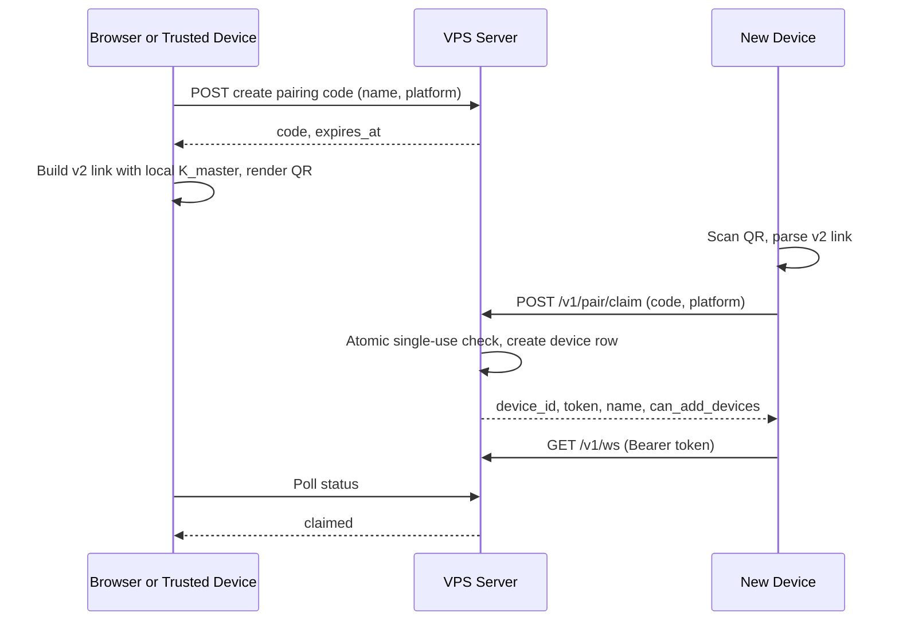

# Pairing Web UI & One-Time Pairing Codes (Phase 5)

Makes adding a device a 30-second, no-SSH task while keeping the VPS zero-knowledge. Two entry points share one backend:

- **(A) Web admin page** — `https://<relay>/admin`, served by the Go server. Used for first-time setup and device management.
- **(B) "Add device"** — inside the desktop tray app and Android app, shown only on devices marked **trusted** (`can_add_devices`).

Both produce a **pairing link v2** carrying a **one-time pairing code** instead of a permanent token. The new device redeems the code for its real token.

---

## 1. Invariants (Phase 5 additions)

1. **`K_master` never reaches the server.** The browser (A) or the trusted device (B) builds the pairing link and renders the QR locally. No request body, header, query string, log line, or DB row on the server contains `K_master`.
2. **Browser key lives in tab memory only.** Never written to `localStorage`, `sessionStorage`, `IndexedDB`, or cookies; gone on tab close.
3. **Pairing codes are single-use, expire after 10 minutes, and are stored hashed** (`sha256`). Claiming is atomic.
4. **Trusted devices can only create pairing codes.** Listing, renaming, revoking devices and toggling `can_add_devices` are web-admin only (a stolen phone cannot revoke your other devices or grant itself more power).
5. **Admin page is never reachable with a known default password.** A random password is generated on first start and must be changed on first login.
6. **v1 pairing links keep working** on Android and desktop; the CLI `token create` stays as a fallback, but its `--key` flag is removed.

> **Trust caveat (accepted)**: the server serves the admin page's JavaScript, so a compromised VPS could serve a key-stealing page. This is the same trust level as running the CLI on the VPS today; it is not a regression.

---

## 2. Pairing Link v2

```text
allnotify://pair?v=2&url=<urlenc_https_url>&code=<pairing_code>&key=<base64url_K_master>&name=<urlenc_name>
```

| Param | Rule |
| :--- | :--- |
| `v` | `2` |
| `url` | Same normalization as v1 (no userinfo/query/fragment, trailing `/` stripped, derive `wss://…/v1/ws`). |
| `code` | `pc_` + 22 chars base64url (128 random bits). Regex `^pc_[A-Za-z0-9_-]{22}$`. |
| `key` | 32-byte `K_master`, base64url no padding (same as v1). |
| `name` | Suggested display name (informational; the server's name for the code wins on claim). |

- v2 links MUST NOT contain `token` or `device_id`; parsers reject v2 links that do.
- Parsers accept `v=1` (existing format, unchanged) and `v=2`; reject any other `v`.
- `protocol/test_vectors.json` gains `pairing_uri_vectors.valid` / `.invalid` entries for v2 (expected fields: `v`, `url`, `ws_url`, `code`, `key_base64url`, `key_hex`, `device_name`) plus invalid cases: v2 with `token`, malformed `code`, missing `code`, `v=3`.

### Key Check Value (KCV)
So a mistyped or wrong pasted key is caught before pairing a device that can never decrypt anything:

```text
KCV = hex( HKDF-SHA256(K_master, salt="", info="all-notify:v1:kcv", len=16) )
```

- Computed in the browser / on the device; the server stores only the KCV (a one-way 128-bit value; reveals nothing usable about `K_master`).
- Set once during first web setup (or "I already have a key" import). When an admin pastes a key later, the page compares KCVs locally and refuses a mismatch.
- Added to `test_vectors.json` under `kdf.kcv_info` / `kdf.kcv_hex`; Go, Kotlin, Rust, and the admin page JS must match.

---

## 3. Flows

### 3.1 First-time setup (web)
1. Operator starts the server. If no admin credential exists, the server generates a random 20-char password, stores its argon2id hash with `must_change=1`, and prints **once** to stdout:
   `ADMIN INITIAL PASSWORD (shown once, change on first login): <password>` — the one sanctioned secret log line.
2. Operator opens `/admin`, logs in, and is forced to the **Change password** screen (min 12 chars) before anything else works.
3. **Key setup** (only if server has no KCV):
   - *Generate new key*: browser runs `crypto.getRandomValues(32)`, shows it, offers **Copy** and **Download `all-notify-key.txt`**, and requires ticking **"I've saved this key"**.
   - *I already have a key*: paste existing `K_master` (for deployments paired via v1/CLI).
   - Browser computes KCV and sends only the KCV to the server.
4. **Create device**: name + platform (+ "Can add devices" checkbox) → server returns a pairing code → browser builds the v2 link with the in-memory key → renders QR + copyable link + 10-minute countdown. Status flips to **Claimed ✓** when redeemed.

### 3.2 Later devices via web
Log in → paste key (KCV-checked, held in tab memory) → Create device → QR.

### 3.3 Add device from a trusted device (B)
1. Client calls `GET /v1/me` on connect; shows **Add device** only if `can_add_devices=true`.
2. User enters name + platform → `POST /v1/pairing-codes` (own bearer token).
3. Client builds the v2 link with its Keychain/Keystore `K_master`, renders the QR locally, shows countdown, polls `GET /v1/pairing-codes` until claimed/expired.

### 3.4 New device redeems the code
1. Scan QR / paste link → parse v2 → `POST /v1/pair/claim {"code": "...", "platform": "android|macos|windows"}`.
2. On `200`: store `device_id` + `token` + `K_master` securely, connect WebSocket. On `410 CODE_EXPIRED_OR_USED` / `404`: show "This pairing code expired or was already used — create a new one."
3. A device that already holds credentials and scans a link with a **different** `url` or KCV must confirm "Replace current pairing?" before overwriting.



---

## 4. HTTP API

All JSON. Errors: `{"error": {"code": "...", "message": "..."}}`.

### 4.1 Public / device endpoints
| Method & Path | Auth | Purpose |
| :--- | :--- | :--- |
| `POST /v1/pair/claim` | none (rate-limited: 10/min per IP) | Body `{code, platform}` → `200 {device_id, token, name, platform, can_add_devices}`; `404 CODE_NOT_FOUND`; `410 CODE_EXPIRED_OR_USED`; `429`. |
| `GET /v1/me` | device bearer | `{device_id, name, platform, can_add_devices}` |
| `POST /v1/pairing-codes` | trusted device bearer | Body `{name, platform}` → `201 {code_id, code, name, platform, expires_at}`. `403 NOT_TRUSTED` if `can_add_devices=0`. Codes created here always have `can_add_devices=0`. Max 5 pending codes per creator. |
| `GET /v1/pairing-codes` | trusted device bearer | Creator's own codes from the last 24h: `[{code_id, name, platform, status: pending|claimed|expired|cancelled, claimed_device_id, expires_at}]` (never returns `code`). |

### 4.2 Admin endpoints (`/admin/api/*`)
Session cookie `an_admin` (HttpOnly, Secure, SameSite=Strict, Path=/admin, 30-min idle expiry, refreshed on use). State-changing requests also require header `X-AllNotify-Admin: 1` and a same-origin `Origin` (CSRF defense). While `must_change=1`, every endpoint except `session`, `password`, `logout` returns `403 PASSWORD_CHANGE_REQUIRED`.

| Method & Path | Purpose |
| :--- | :--- |
| `POST /admin/api/login` | `{password}` → sets cookie. Rate limit: 5 failures per IP per 15 min → `429`. Constant-time compare via argon2id. |
| `POST /admin/api/logout` | Deletes session. |
| `GET /admin/api/session` | `{logged_in, must_change_password, kcv_set}` |
| `POST /admin/api/password` | `{current, new}` (new ≥ 12 chars, ≠ current) → rehash, clear `must_change`, invalidate all other sessions. |
| `GET /admin/api/kcv` / `PUT /admin/api/kcv` | Read / set KCV. `PUT` only allowed when unset (changing it = key rotation, out of scope). |
| `GET /admin/api/devices` | `[{id, name, platform, can_add_devices, online, last_seen, created_at, revoked_at}]` |
| `PATCH /admin/api/devices/{id}` | `{name?, can_add_devices?}` |
| `POST /admin/api/devices/{id}/revoke` | Sets `revoked_at`, closes live WS (`1008 revoked`). |
| `POST /admin/api/pairing-codes` | `{name, platform, can_add_devices}` → `201 {code_id, code, expires_at, ...}` |
| `GET /admin/api/pairing-codes` | All codes from last 24h with status (never returns `code`). |
| `DELETE /admin/api/pairing-codes/{id}` | Cancel a pending code. |

### 4.3 Static admin UI
`GET /admin` and `GET /admin/assets/*` served from `go:embed` (`server/internal/admin/web/`). Headers on every `/admin` response:
`Content-Security-Policy: default-src 'none'; script-src 'self'; style-src 'self'; img-src 'self' data:; connect-src 'self'; frame-ancestors 'none'; base-uri 'none'; form-action 'self'`, `X-Frame-Options: DENY`, `Referrer-Policy: no-referrer`, `Cache-Control: no-store`, `X-Content-Type-Options: nosniff`.

---

## 5. Server Data Model

Schema changes ship as an idempotent migration keyed on `PRAGMA user_version` (current deployments have `user_version=0`; migration 1 adds the following). Existing devices keep working untouched.

```sql
ALTER TABLE devices ADD COLUMN can_add_devices INTEGER NOT NULL DEFAULT 0;

CREATE TABLE pairing_codes (
    id                 TEXT PRIMARY KEY,         -- "pcid_<ULID>" (safe to show/log)
    code_hash          TEXT NOT NULL UNIQUE,     -- hex(sha256(code))
    name               TEXT NOT NULL,
    platform           TEXT NOT NULL,            -- android|macos|windows
    can_add_devices    INTEGER NOT NULL DEFAULT 0,
    created_by         TEXT NOT NULL,            -- "admin" or device id
    created_at         INTEGER NOT NULL,
    expires_at         INTEGER NOT NULL,         -- created_at + 10 min
    claimed_at         INTEGER,
    claimed_device_id  TEXT,
    cancelled_at       INTEGER
);
CREATE INDEX idx_pairing_codes_created_by ON pairing_codes(created_by, created_at);

CREATE TABLE admin_credentials (
    id             INTEGER PRIMARY KEY CHECK (id = 1),
    password_hash  TEXT NOT NULL,               -- argon2id PHC string
    must_change    INTEGER NOT NULL DEFAULT 1,
    updated_at     INTEGER NOT NULL
);

CREATE TABLE admin_sessions (
    token_hash   TEXT PRIMARY KEY,              -- hex(sha256(cookie value))
    created_at   INTEGER NOT NULL,
    expires_at   INTEGER NOT NULL
);

CREATE TABLE settings (
    key    TEXT PRIMARY KEY,                    -- e.g. "kcv"
    value  TEXT NOT NULL
);
```

- **Claim** runs in one transaction: `UPDATE pairing_codes SET claimed_at=now WHERE code_hash=? AND claimed_at IS NULL AND cancelled_at IS NULL AND expires_at>now` → if 1 row, insert the `devices` row (new `dev_<ULID>`, fresh token) and set `claimed_device_id`.
- **Reaper** (existing 15-min loop) also deletes `pairing_codes` older than 24h and expired `admin_sessions`.
- Sessions live in SQLite (not memory) so `admin reset-password` from the CLI can invalidate them.
- argon2id parameters: `time=2, memory=64 MiB, threads=1, keyLen=32`, 16-byte salt (`golang.org/x/crypto/argon2`, already a dependency).

---

## 6. CLI Changes

```bash
# New: generate a fresh random admin password (printed once), set must_change=1, delete all admin sessions
all-notify-server admin reset-password

# Changed: --key and --url removed (QR containing K_master is no longer rendered on the VPS)
all-notify-server token create --name "Pixel 9" --platform android [--can-add-devices]
# New: create a v2 one-time pairing code (prints code + expiry; build the link on a trusted device or the web page)
all-notify-server pair create --name "Pixel 9" --platform android [--can-add-devices]
```

`token create` passing `--key` exits with an error pointing to `/admin` or `pair create`.

---

## 7. Configuration

| Env Variable | Default | Description |
| :--- | :--- | :--- |
| `ALLNOTIFY_ADMIN_ENABLED` | `true` | Set `false` to not mount `/admin` at all. |
| `ALLNOTIFY_PAIRING_CODE_TTL_MINUTES` | `10` | One-time code lifetime. |
| `ALLNOTIFY_ADMIN_SESSION_MINUTES` | `30` | Idle session lifetime. |
| `ALLNOTIFY_TRUST_PROXY` | `false` | When `true`, rate limiters read client IP from `X-Forwarded-For` (set when behind Caddy/Nginx). |

Reverse proxies must forward `/admin` and `/v1/pair`, `/v1/me`, `/v1/pairing-codes` in addition to `/v1/ws` and `/v1/blobs`.

---

## 8. Client Changes

### Android
- `PairingUriParser`: accept v2 (`code`), keep v1; pass new vectors.
- Pairing flow: v2 → `POST /v1/pair/claim` → store credentials → start service. Confirm before replacing an existing pairing.
- On connect: `GET /v1/me`; persist `can_add_devices`.
- Settings → **Add device** (trusted only): name + platform form → `POST /v1/pairing-codes` → render QR with ZXing `BarcodeEncoder` (already a dependency) + share/copy link + countdown + status polling (every 3 s while visible). Remove the old "copy group key/URI" helper.
- Set `FLAG_SECURE` on the Add-device screen (QR contains `K_master`; blocks screenshots/recents thumbnail).

### Desktop (Tauri)
- `crypto.rs` pairing parser: accept v2, keep v1; pass new vectors.
- Pairing view: v2 → claim via `reqwest` → keyring → connect. Confirm before replacing.
- On connect: `GET /v1/me`; persist `can_add_devices` in `pairing.json`.
- Settings → **Add device** (trusted only): Rust command creates code, builds link with keyring key, renders SVG via the existing `qrcode` crate, returns SVG + link to the popover; countdown + polling.
- macOS: set the window `contentProtection` (`setContentProtected(true)`) while the Add-device QR is visible; Windows: `SetWindowDisplayAffinity(WDA_EXCLUDEFROMCAPTURE)` via Tauri `set_content_protected(true)`.

### Admin page (`server/internal/admin/web/`)
- `index.html`, `admin.css`, `admin.js`, `qrcode.min.js` (vendored, MIT, pinned version + SHA-256 noted in a header comment). No build step, no CDN.
- Views: Login → Change password (forced) → Key setup (generate/import, save gate) → Devices (list, online dot, last seen, rename, trusted toggle, revoke with confirm) → Create device (QR + link + countdown + live status) → Settings (change password).
- HKDF-SHA256 for KCV via WebCrypto (`crypto.subtle.deriveBits`), base64url helpers, no other crypto in the browser.

---

## 9. Verification (Phase 5 exit)

- `protocol`: vectors regenerate deterministically, include v2 + KCV.
- `server` (`go test -race ./...`): migration on a v1 DB keeps existing devices + tokens valid; first-boot password printed once and never again; forced change; login rate limit; CSRF header/Origin rejection; session expiry + invalidation on password change and CLI reset; claim is single-use under concurrent claims (race test); expired/cancelled codes → `410`; non-trusted device → `403` on `/v1/pairing-codes`; trusted device cannot list/revoke/rename; revoke closes WS; no request/log/DB contains the test `K_master` (grep DB + captured logs); CSP headers present.
- `android` + `desktop`: v1 + v2 parser vectors, claim happy/expired paths against the real Go server, Add-device hidden when untrusted, QR round-trip (render → decode → parse equals input).
- Manual: fresh VPS → first login → generate key → pair Android via QR → mark trusted → Add device from Android → pair Mac → pair Windows from Mac; existing v1-paired vivo phone keeps working without re-pairing.
