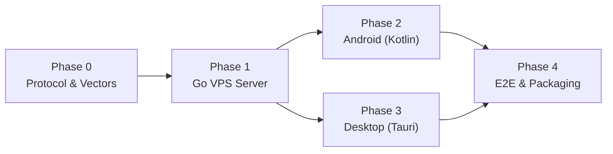

# Phased Delivery Roadmap

This roadmap tracks **All-Notify** from initial protocol freeze to a daily-driver v1.0 release across your VPS, Android phones, macOS, and Windows devices, plus planned v2.0 enhancements.

---

## Phase Overview

| Phase | Name | Primary Deliverable | Depends On | Exit Gate |
| :--- | :--- | :--- | :--- | :--- |
| **Phase 0** | Protocol & Crypto Vectors | `protocol/` JSON schemas & cross-language E2EE test vectors | None | Test vectors generated, verified, and frozen for `v1`. |
| **Phase 1** | Go VPS Relay Server | `server/` static binary, CLI, SQLite queue, Blob API, Docker/Caddy | Phase 0 | `go test ./...` passes; two simulated clients relay encrypted events & blobs through Dockerized server. |
| **Phase 2** | Native Kotlin Android App | `android/` sideloadable APK (capture, mirror, dismiss, icons/images, history) | Phase 0, Phase 1 | Two Android devices mirror text/icons/images and sync dismissals bidirectionally via VPS. |
| **Phase 3** | Tauri Desktop App (Win + Mac) | `desktop/` tray/menu-bar app for macOS & Windows | Phase 0, Phase 1 | Android notifications appear natively on macOS & Windows; desktop Dismiss clears Android & other devices. |
| **Phase 4** | E2E Hardening & Packaging | Full cross-device E2E matrix, GitHub Actions builds, VPS deployment | Phase 2, Phase 3 | All E2E test scenarios pass; automated builds produce Linux server, APK, `.dmg`, and `.msi`. |

---

## Parallelism & Dependency Flow

Once **Phase 0** and **Phase 1** are complete, **Phase 2 (Android)** and **Phase 3 (Desktop)** can proceed in parallel against the live relay server.

---

## Detailed Milestones (v1.0)

### Phase 0 — Protocol & Shared Crypto Vectors
- **M0.1**: Freeze outer WS frames (`relay`, `event`, `replay_complete`, `ack`, `error`) and inner decrypted schemas (`notification.posted`, `notification.dismissed`).
- **M0.2**: Generate deterministic `protocol/test_vectors.json` covering `HKDF-SHA256`, `XChaCha20-Poly1305` (with AAD), and `allnotify://pair` URI parsing.

### Phase 1 — Go VPS Relay Server
- **M1.1**: SQLite storage layer (`devices`, `offline_events`, `blobs`) in WAL mode with 24h TTL reaper.
- **M1.2**: CLI tooling (`keygen`, `token create` with terminal QR, `token list`, `token revoke`, `serve`).
- **M1.3**: WebSocket hub with single-socket-per-device enforcement, offline replay + `replay_complete`, live fan-out, and `ack` pruning.
- **M1.4**: HTTPS E2EE Blob API (`HEAD`/`PUT`/`GET /v1/blobs/{id}`) with 550 KB cap and disk quota eviction.
- **M1.5**: Multi-stage `Dockerfile` + `docker-compose.yml` (standalone Caddy auto-TLS or behind existing Nginx/Caddy).

### Phase 2 — Native Kotlin Android App
- **M2.1**: Crypto & pairing core passing `protocol/test_vectors.json`, backed by Android Keystore.
- **M2.2**: Persistent `RelayForegroundService` WebSocket with exponential backoff, network-change reconnect, Room `outbox`, and `replay_complete` batching.
- **M2.3**: `AllNotifyListenerService` capture pipeline (loop guard, ongoing/media/low-priority filters, per-app toggles, `64×64` WebP icon hash cache, `≤800px / ≤512 KB` image E2EE upload, `cancelNotification` on remote dismiss).
- **M2.4**: Receiver pipeline (5s cross-device dedup, Pause/Mute + OS DND respect, mirrored notifications with `DeleteIntent` dismissal sync, Room history + daily 30d/5,000-row retention worker).
- **M2.5**: Minimal Jetpack Compose UI (onboarding/permissions/ZXing QR scanner, searchable history, app filter list, settings).

### Phase 3 — Tauri Desktop App (Windows & macOS)
- **M3.1**: Rust E2EE crypto & pairing parser passing `protocol/test_vectors.json`, with OS Keychain storage.
- **M3.2**: Rust WS client, offline replay drain (anti-popup-storm), 5s dedup, blob/icon cache, and SQLite history + retention sweeper.
- **M3.3**: `PlatformNotifier` implementations:
  - **macOS**: `UNUserNotificationCenter` with explicit **Dismiss** action button + attachments.
  - **Windows**: WinRT Toast with **Dismiss** action button, native `UserCanceled` swipe-dismiss hook, and hero images.
- **M3.4**: System tray / menu-bar icon states and compact Svelte/vanilla popover UI (search, active/dismissed feed, image preview, Mute/Pause toggle, pairing & settings).

### Phase 4 — E2E Hardening & Packaging
- **M4.1**: Execute full cross-device E2E verification matrix (Android ↔ Android, Android → macOS/Windows, sleep/wake replay, 5s dedup, token revocation).
- **M4.2**: Set up GitHub Actions CI/CD to build Linux `amd64`/`arm64` server binary/Docker image, Android APK, macOS `.dmg`, and Windows `.msi`/`.exe`.
- **M4.3**: Deploy to personal VPS and run 48-hour real-world soak test (battery, memory, reconnect resilience).

---

## Key Risks & Mitigations

| Risk | Impact | Mitigation |
| :--- | :--- | :--- |
| **Aggressive OEM battery killers on Android** (Xiaomi, Samsung, OnePlus) | Persistent Foreground Service killed in background | Guided onboarding for `REQUEST_IGNORE_BATTERY_OPTIMIZATIONS`, sticky service (`START_STICKY`), `NetworkCallback` + `WorkManager` watchdog. |
| **Cross-language E2EE mismatch** (Go vs. Kotlin vs. Rust) | Decryption failures between devices | Mandatory `protocol/test_vectors.json` run in every language's unit test suite before any integration work. |
| **macOS swipe-dismiss silence** | Swiping a macOS banner doesn't fire an app callback | Provide an explicit **Dismiss** action button on every macOS notification + one-click dismiss in the menu-bar popover. |
| **Popup storm after laptop sleep** | Dozens of stale popups fire on wake | Buffer replayed events until `replay_complete`; archive already-dismissed items silently; collapse >5 still-active items into a summary popup. |
| **Large media / spammy apps exhausting VPS disk** | VPS storage fills up or WS stalls | Compress images on Android (`≤800px`, `≤512 KB`), enforce 550 KB server cap, 24h TTL reaper, and `256 MB` hard total-blob LRU cap. |

---

## Post-v1.0 Backlog (Deferred)

- **v1.1**: Inline quick-reply from desktop/other Android phones (`RemoteInput` forwarding); clipboard sync toggle.
- **v1.2**: Granular per-app-to-device routing rules (e.g., work apps only to work laptop); quiet schedules.
- **v2.0**: iOS receive-only companion (via APNs gateway or self-hosted Web Push); optional BLE ANCS bridge on macOS/Linux for iOS capture.
